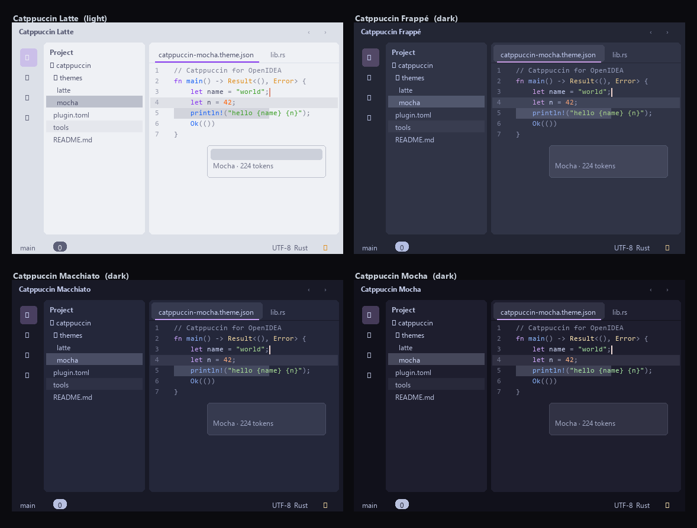

# Catppuccin for OpenIDEA

四个 Catppuccin 口味（flavour），每个都设满 OpenIDEA 全部 **224 个可主题化 token**
（117 个 UI token + 107 个编辑器/语法/ANSI token）：

| 主题 | `kind` | 底色 |
|---|---|---|
| Catppuccin Latte | `light` | `base #eff1f5` |
| Catppuccin Frappé | `dark` | `base #303446` |
| Catppuccin Macchiato | `dark` | `base #24273a` |
| Catppuccin Mocha | `dark` | `base #1e1e2e` |



> 预览图是 `tools/preview.py` 用生成出来的 token 文件渲染的示意图，不是 IDE 截图，
> 但每一处颜色都直接读自 `themes/*.json`，所以能用来检查映射有没有写错。

## 安装

主题插件是**纯数据**的：没有 wasm、没有权限、不需要编译，这个文件夹本身就是插件包。

**方式一：从磁盘安装（日常用）**
设置 › 插件 › 齿轮 ⚙ › *Install Plugin from Disk…* → 选这个文件夹。

**方式二：打成签名包**
```sh
openidea-plugin pack . --key muecheack.key --publisher muecheack
# -> muecheack.catppuccin-1.0.0.oiplugin   (signed by muecheack)
```
然后用 *Install Plugin from Package File…* 选它。私钥只留在本机：`*.key` 已在 `.gitignore` 里。

**方式三：开发模式（改颜色时用，不用反复装）**
```sh
openidea-plugin link .          # 挂到当前 IDE
openidea-plugin check .         # 装之前先按 IDE 的规则校验一遍
```
改完文件在 设置 › 插件 里点 *Reload*（或执行 *Reload Plugins*）即可生效。

**应用主题：** 设置 › 外观 › 主题 → 选 *Catppuccin Mocha* 等四个之一。
*Use Default Theme* 切回内置主题；禁用/卸载插件后也会自动回到内置主题。

> 注意：如果你在 设置 › 外观 里手动选过强调色（accent），它会盖在主题的 `--accent`
> 之上；想看到 Catppuccin 自己的 mauve 紫，把 accent 恢复默认。

## 目录结构

```
plugin.toml                             清单：4 条 [[contributes.themes]]
themes/catppuccin-<flavour>.theme.json  117 个 UI token
themes/catppuccin-<flavour>.scheme.json 107 个语法/编辑器/ANSI token
tools/palette.json                      Catppuccin 官方调色板（26 色 × 4 口味 + ANSI）
tools/tokens.txt                        OpenIDEA 的 382 个 CSS 变量名，用来防止拼错
tools/gen_themes.py                     生成器：调色板 + 映射 → 8 个 JSON
tools/check_manifest.py                 按 OpenIDEA 0.1.x 规则校验清单
tools/preview.py                        渲染上面的预览图
LICENSE-catppuccin                      Catppuccin 的 MIT 许可证
```

`*.theme.json` 和 `*.scheme.json` 是**生成产物**，不要手改——改 `tools/gen_themes.py`。
IDE 安装时只复制 `plugin.toml` 引用到的文件，`tools/` 不会进插件包。

## 版本兼容（重要）

目标版本：**OpenIDEA 0.1.37**（实测安装版本）。

### id 为什么带点

`id = "muecheack.catppuccin"` 里的点是**必须的**，不是风格偏好。`openidea-plugin pack
--key` 的签名规则是字面前缀匹配：

```rust
if !manifest.id.starts_with(&format!("{publisher}.")) {
    return Err(format!("publisher {publisher:?} may only sign plugins named {publisher}.*"));
}
```

publisher 是 `muecheack`，所以 id 必须是 `muecheack.` 开头。而 0.1.x 把 id 校验成
`[a-z0-9][a-z0-9_-]*`（不许点），于是**签名和 0.1.x 互斥**：0.1.x 时代没有签名这条路，
带点 id 也装不进 0.1.x。本插件因此要求 **OpenIDEA 1.x**。

### 清单为什么还是 0.1 格式

`plugin.toml` 用 `openidea-api = "0.1"`，不是 `engines.openidea`。1.x 会把它当 legacy
清单读进来（`openidea-plugin check` 会提示一句 "uses the 0.1 format"），功能上没差别——
`categories` 是**从 contributes 推导**的，贡献了 themes 就自动归到 themes 类，不用手写。

这样文件对版本变化更宽容。想迁到 0.2 格式（`engines.openidea` + `[capabilities]`）是可选的
清理，能换来可显式写 `categories` / `license` 两个元数据。

### Token 覆盖

0.1.37 的 `tokens.css` 含全部 **224** 个 token（包括 0.1.33 才加的 `--syn-global`），
所以四个口味是满覆盖，不会有落空的 token。

### 打包与签名

```sh
openidea-plugin pack . --key muecheack.key --publisher muecheack
# -> muecheack.catppuccin-1.0.0.oiplugin   (signed by muecheack)
```

`*.key` 与 `*.oiplugin` 都在 `.gitignore` 里：**私钥绝不入库**，包发到 GitHub Releases。

> 在 0.1.36+ 上，插件主题也会出现在 *设置 › 外观与行为 › 外观 › 主题* 的下拉里
> （0.1.32–0.1.35 只能从插件页应用）。

### 校验

```sh
python tools/check_manifest.py      # 清单字段按 0.1 集，id 按 1.x 规则
openidea-plugin check .             # 文件夹
openidea-plugin check *.oiplugin    # 包文件，按安装时的规则
python tools/gen_themes.py --check  # 主题文件与生成器是否一致
```

> 历史坑：这个项目最初在 **0.1.32** 上装不上，因为 CLI/脚手架是 1.x 时代的，撞了三处
> 错位——`categories` 字段、带点 id、签名命名空间。`tools/check_manifest.py` 就是当时
> 加的守门员：`openidea-plugin check` 会放行一些旧 IDE 不认的东西，它不会。

## 映射原则

整体思路：**Catppuccin 决定颜色，OpenIDEA 决定语义。** 取官方
[style guide](https://github.com/catppuccin/catppuccin/blob/main/docs/style-guide.md)
里的语义表，套到 OpenIDEA 的 token 上。

**布局：** OpenIDEA 是 IntelliJ 新 UI 的 "islands" 结构——外框（frame）包着浮起来的
编辑器岛（island）。所以：

| OpenIDEA token | 取值 | 说明 |
|---|---|---|
| `--bg-island` | `base` | 编辑器岛，两个 kind 下都是最"亮"那一层 |
| `--bg-frame` | `crust` | 最外框 |
| `--bg-app` | `mantle` | 岛与岛之间的底 |
| `--bg-popup` | `surface0`（暗）/ `base`（亮） | 浮层要比底更醒目 |
| `--bg-hover` → `--bg-selected` → `--bg-selected-strong` | `surface0` → `1` → `2` | 三级递进 |

**语义：**

| 用途 | 颜色 |
|---|---|
| 强调色 `--accent` | `mauve`（Catppuccin 的标志色） |
| 链接 | `blue` |
| 错误 / 警告 / 成功 | `red` / `yellow` / `green` |
| 光标 `--caret` | `rosewater`（style guide：Cursor） |
| 当前行 | `text` @ 10%（style guide：Cursor Line） |
| 编辑器选区 | `overlay2` @ 30%（style guide：20–30%） |
| 行号 | `overlay0` / `overlay1` |
| 文本层级 | `text` → `subtext1` → `subtext0` → `overlay1` → `overlay0` |

**语法高亮**直接照抄 style guide 的 Code Editors 表：

| 语法元素 | 颜色 | 语法元素 | 颜色 |
|---|---|---|---|
| 关键字 | `mauve` | 方法、函数 | `blue` |
| 字符串 | `green` | 参数 | `maroon` |
| 类型、类、注解 | `yellow` | 内置 | `red` |
| 常量、数字 | `peach` | 属性 | `blue` |
| 转义、正则 | `pink` | 宏 | `rosewater` |
| 注释 | `overlay2`（斜体） | 运算符 | `sky` |
| 括号、分隔符 | `overlay2` | 标签 tag | `mauve` |

**调色板里没有的色阶**（比如 10% 透明度的当前行、diff 背景、反馈条底色）用
`rgba(<调色板颜色>, α)` 混出来，这样四个口味都能自动跟着走，而不会写死成某个口味的数。

**一处刻意的偏离：** 状态栏计数徽章用 `subtext1` 底 + `base` 字，而不是
`surface2` + `text`——后者在 Latte 上只有 3.69:1，过不了 WCAG AA，前者四个口味
都 ≥ 5.2:1。

## 改颜色 / 重新生成

```sh
python tools/gen_themes.py            # 重新生成 8 个 JSON
python tools/gen_themes.py --check    # 只校验：token 名是否都存在、数量对不对、是否最新
python tools/preview.py --out preview.png
```

生成器会做这些检查，任一失败就非零退出：

- 每个 token 名必须出现在 `tools/tokens.txt`（防止 `--bg-eleve` 这种拼错静默失效）
- UI 恰好 117 个、scheme 恰好 107 个，且两文件不重叠
- 值的合法性按 `crates/ide-host/src/plugins/theme.rs` 的 `is_safe_value` 来：
  禁止 `url(` / `image(` / `@import` / `expression(` / `;` / `{}` / `<>` / `\`，长度 ≤ 256
- 十六进制统一小写
- **正文文字**对比度必须 ≥ 4.5:1（WCAG AA）

## 自己做一个主题插件的思路

想换别的配色（Dracula、Nord、Rose Pine…）照着这套流程走：

1. **起项目**
   ```sh
   openidea-plugin new my-theme --template theme --id my-theme --name "My Theme"
   ```
   或用官方的完整范例 `plugins/official/harbor-night`（它把每个 token 都写满了，最适合抄）。

2. **搞清楚 token** 读 `docs/plugins/themes.md`。里面的 Token Reference 是自动生成的，
   224 个 token 按 Surfaces / Lines / Text / Accent / Status / Vcs / Syntax / Editor /
   ANSI 分组，还列了 Islands Dark 和 Islands Light 的取值——**这就是你的参照系**：
   拿你新主题的深色版对着 Islands Dark 一格一格换。

3. **别从零开始映射** 文档里有两张现成的映射表：
   - **VS Code 主题**：`colors` 键 → OpenIDEA token；`tokenColors` 的 TextMate scope → `--syn-*`
   - **IntelliJ 主题**：`.theme.json` 的 `ui` 键、`.icls` 的 option → token

   有现成的 VS Code / IntelliJ 主题时，这两张表能省掉八成工作。而且 IDE 自带
   *Import IntelliJ Theme from File…* 和 `pnpm theme:import-intellij` 脚本，能
   直接转成插件文件夹，转完你再手工修。

4. **`kind` 必须诚实** 浅色主题写 `light`。`kind` 决定用哪套内置底图和图标；
   主题没写的 token 会继承该 kind 的内置值。

5. **写满 224 个 token** 只写十几个也能用（缺的继承内置值），但 IDE 以后调色板一变
   你的主题就会花。写满才稳。

6. **校验再装** `openidea-plugin check .`——它按 IDE 安装时的规则读清单、解析 JSON、
   跑 `validate()`，报错会带文件和行号。

7. **迭代** `openidea-plugin link .` + *Reload*，不用反复安装。
   检查这几处：工程树带选中、几个语言的编辑器、Search Everywhere、弹窗、tooltip、
   设置页、终端 `ls --color`、diff、Commit 窗口的 VCS 颜色。

## 已知取舍

Catppuccin Latte 的官方调色板**本身**在浅色底上就有几处达不到 AA 4.5:1，这是上游
设计，不是移植错误。实测（Latte `base #eff1f5` 上）：

| token | 颜色 | 对比度 |
|---|---|---|
| `--syn-type` / `--warning` | `yellow #df8e1d` | 2.31:1 |
| `--syn-number` / `--syn-constant` | `peach #fe640b` | 2.64:1 |
| `--fg-subtle` | `overlay1 #8c8fa1` | 2.83:1 |
| `--syn-string` / `--success` | `green #40a02b` | 2.96:1 |
| `--syn-comment` | `overlay2 #7c7f93` | 3.49:1 |
| `--link` / `--syn-function` | `blue #1e66f5` | 4.34:1 |
| `--fg-muted` | `subtext0 #6c6f85` | 4.37:1 |

想强行达标就得压暗这些色相，那就不再是 Latte 了。所以这里保留官方取值；日常用
深色口味（Mocha 等）没有这个问题，正文全部过 AA。

## 许可与致谢

调色板、语义规范来自 [Catppuccin](https://catppuccin.com)，MIT 许可证，
见 `LICENSE-catppuccin`。本移植同样以 MIT 发布。

Catppuccin 是社区设计系统，与 OpenIDEA 无关；这个插件是第三方移植。
